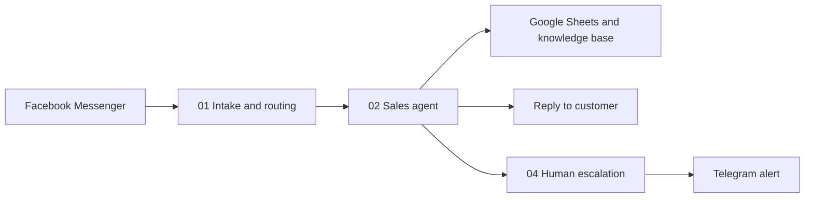

# AI Sales Agent for Social Commerce

مشروع أتمتة مبيعات عبر **Facebook Messenger** مبني باستخدام **n8n**. يستقبل رسائل العملاء ويفهم النصوص والرسائل الصوتية والصور والفيديوهات والمنشورات المشتركة، ثم يجيب اعتماداً على بيانات المنتجات والمخزون وسياسة المتجر، ويسجل الطلبات في Google Sheets، مع إمكانية تحويل المحادثة إلى موظف.

> **الحالة:** معدّ للعمل مع Facebook Messenger. تكامل Instagram وWhatsApp غير مضمّن حالياً.

## المزايا

- فهم رسائل النص والصوت والصور والفيديو والمنشورات والريلز.
- تجميع الرسائل المتتابعة قبل الرد عليها.
- الرد بالعربية والدارجة الجزائرية والفرنسية.
- اقتراح المنتجات مع الصور والأسعار والتحقق من المخزون.
- البحث في قاعدة معرفة المتجر للإجابة عن أسئلة السياسات.
- حساب التوصيل اعتماداً على جدول الأسعار.
- تسجيل الطلبات وتحديث المخزون في Google Sheets.
- تحويل المحادثة إلى موظف وإرسال تنبيه عبر Telegram.
- تشغيل البوت وإيقافه، وإعادة تفعيله تلقائياً.
- إرسال تنبيهات عند حدوث أخطاء.

## كيف يعمل؟



## سير العمل

| الملف | الوظيفة |
|---|---|
| `01-intake-and-routing.json` | استقبال رسائل Messenger ومعالجتها وتوجيهها إلى الوكيل |
| `02-sales-agent.json` | وكيل المبيعات وأدوات المنتجات والمخزون والطلبات والتوصيل |
| `03-knowledge-base.json` | تحميل محتوى قاعدة المعرفة واختباره |
| `04-escalate-to-human.json` | تحويل المحادثة إلى موظف وإرسال تنبيه Telegram |
| `05-telegram-bot-control.json` | التحكم في تشغيل البوت وإيقافه عبر Telegram |
| `06-auto-reactivation.json` | إعادة تفعيل البوت تلقائياً للعملاء المتوقف عندهم |
| `07-error-handler.json` | معالجة الأخطاء وإرسال التنبيهات وتسجيلها |
| `08-generate-product-images.json` | إنشاء صور المنتجات وتحديث روابطها في Google Sheets |

## التقنيات والخدمات

| الخدمة | الاستخدام |
|---|---|
| n8n | تشغيل وربط جميع مسارات العمل |
| OpenRouter | نماذج الذكاء الاصطناعي والرؤية |
| Groq | تحويل الرسائل الصوتية إلى نص |
| OpenAI | Embeddings لقاعدة المعرفة |
| ElevenLabs | تحويل الردود إلى صوت |
| Meta Graph API | Facebook Messenger وقراءة تفاصيل المنشورات |
| Google Sheets | المنتجات والمخزون والتوصيل والطلبات والتحكم بالبوت |
| Redis | تجميع الرسائل المتتابعة |
| PostgreSQL | ذاكرة المحادثات وسجل الأخطاء |
| Supabase | قاعدة المعرفة باستخدام pgvector |
| Telegram | تنبيهات المالك والتحكم بالبوت |
| imgbb | رفع صور المنتجات في Workflow 08 |

## ملفات البيانات

يوجد ملف واحد هو [`data/All_Sheets.xlsx`](data/All_Sheets.xlsx)، ويحتوي على أوراق Google Sheets المطلوبة:

- `Products`
- `Inventory`
- `Orders`
- `Yalidine_Tarifs`
- `Bot_Control`

استعمل عناوين الأعمدة الموجودة في كل ورقة لإنشاء الأوراق المطابقة داخل Google Sheets. لا ترفع بيانات عملاء حقيقية إلى المستودع.

## هيكلة المستودع

```text
ai-sales-agent-main/
├── README.md
├── .env.example
├── LICENSE
├── data/
│   └── All_Sheets.xlsx
├── docs/
│   ├── architecture.md
│   └── setup.md
└── workflows/
    ├── 01-intake-and-routing.json
    ├── 02-sales-agent.json
    ├── 03-knowledge-base.json
    ├── 04-escalate-to-human.json
    ├── 05-telegram-bot-control.json
    ├── 06-auto-reactivation.json
    ├── 07-error-handler.json
    └── 08-generate-product-images.json
```

## التشغيل

راجع [دليل الإعداد والتشغيل](docs/setup.md) قبل استيراد Workflows. ستحتاج إلى إعداد Credentials داخل n8n وتعديل القيم النائبة `YOUR_...` داخل ملفات Workflows.

## ملاحظات مهمة

- هذا المستودع يحتوي على ملفات Workflows وملف بيانات Excel، ولا يحتوي حالياً على ملفات SQL مستقلة أو مجلد Prompts أو صور توضيحية.
- تعليمات إنشاء جداول PostgreSQL وSupabase يجب استكمالها وفق إعدادات قاعدة البيانات المستخدمة؛ ملفات SQL غير مرفقة في هذه النسخة.
- لا تنشر مفاتيح API أو Tokens أو بيانات العملاء داخل المستودع.
- تحقق من إعدادات الأمان وWebhook signature verification قبل استخدام النظام في بيئة إنتاجية.

## المؤلف

**Rabie Bouderga** — [Portfolio](https://rabie-bouderga.vercel.app)

## License

[MIT](LICENSE)
