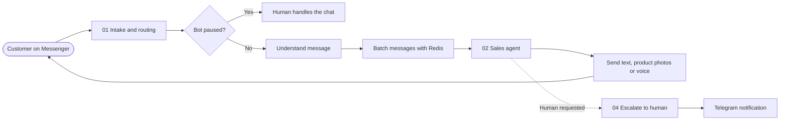

# AI Sales Agent for Social Commerce

An AI-powered sales agent that handles customer conversations on **Facebook Messenger**. It understands text, voice notes, images, videos, shared posts and reels; recommends products with photos and prices; checks stock; calculates delivery fees; records confirmed orders; and hands conversations to a human when needed.

Built with [n8n](https://n8n.io) and designed for the Algerian market (Algerian Darija, wilaya/commune delivery tariffs). It can be adapted to other catalog-based businesses.

> **Status:** Facebook Messenger is supported. Instagram and WhatsApp are not included in the current workflows.

## What it does

- Understands text, voice notes, images, videos, shared posts and reels.
- Combines messages sent in quick succession before generating a reply.
- Responds in Algerian Darija, Arabic, French or a mix, and can send voice replies.
- Recommends products using catalog details, photos, prices and stock availability.
- Answers store-policy questions using a Supabase vector knowledge base.
- Calculates delivery fees using wilaya and commune tariffs.
- Saves confirmed orders in Google Sheets and reserves stock.
- Transfers conversations to a human and notifies the store owner through Telegram.
- Lets the owner pause or reactivate the bot and receive workflow error alerts.

## How it works



See [docs/architecture.md](docs/architecture.md) for the workflow architecture and data flow.

## Workflows

| # | Workflow file | Purpose |
|---|---|---|
| 01 | [01-intake-and-routing.json](workflows/01-intake-and-routing.json) | Receives Messenger events, identifies message types, processes media, batches messages and calls the sales agent. |
| 02 | [02-sales-agent.json](workflows/02-sales-agent.json) | Main AI agent, product and inventory tools, delivery calculation, order registration, memory and customer replies. |
| 03 | [03-knowledge-base.json](workflows/03-knowledge-base.json) | Loads and queries store-policy content using Supabase Vector Store and OpenAI embeddings. |
| 04 | [04-escalate-to-human.json](workflows/04-escalate-to-human.json) | Pauses the bot for a customer and sends the owner a Telegram notification. |
| 05 | [05-telegram-bot-control.json](workflows/05-telegram-bot-control.json) | Handles the owner's bot ON/OFF actions from Telegram. |
| 06 | [06-auto-reactivation.json](workflows/06-auto-reactivation.json) | Reactivates customers' bot access after the configured pause period. |
| 07 | [07-error-handler.json](workflows/07-error-handler.json) | Reports workflow failures through Telegram and logs them in Postgres. |
| 08 | [08-generate-product-images.json](workflows/08-generate-product-images.json) | Generates product images and updates their links in the Products sheet. |

## Tech stack

| Component | Service | Purpose |
|---|---|---|
| Workflow automation | n8n | Runs all eight workflows |
| AI model and vision | Gemini through OpenRouter | Sales agent, media understanding, summaries and error diagnosis |
| Speech to text | Groq Whisper | Transcribes voice messages |
| Text to speech | ElevenLabs | Generates voice replies |
| Messaging | Meta Graph API | Facebook Messenger integration |
| Message batching | Redis | Temporarily buffers incoming messages |
| Conversation memory and logs | PostgreSQL | Stores chat history and error logs |
| Knowledge base | Supabase with pgvector | Searches store policies |
| Business data | Google Sheets | Products, inventory, delivery tariffs, orders and bot status |
| Owner notifications | Telegram | Human handoff, bot controls and error alerts |
| Product image hosting | imgbb | Hosts generated product images in workflow 08 |

## Repository structure

```text
ai-sales-agent-main/
├── README.md
├── .env.example
├── LICENSE
├── data/
│   └── All_Sheets .xlsx       Google Sheets workbook template
├── workflows/
│   ├── 01-intake-and-routing.json
│   ├── 02-sales-agent.json
│   ├── 03-knowledge-base.json
│   ├── 04-escalate-to-human.json
│   ├── 05-telegram-bot-control.json
│   ├── 06-auto-reactivation.json
│   ├── 07-error-handler.json
│   └── 08-generate-product-images.json
└── docs/
    ├── architecture.md
    └── setup.md
```

## Data workbook

The workbook in [`data/All_Sheets .xlsx`](data/All_Sheets%20.xlsx) contains these tabs:

- `Products` — product catalog and image URLs.
- `Inventory` — stock by product, size and color.
- `Orders` — confirmed customer orders.
- `Yalidine_Tarifs` — delivery fees and availability by wilaya and commune.
- `Bot_Control` — customer-level bot pause status.

Use the workbook as a template. Keep the sheet names and column headers unchanged unless you also update the corresponding Google Sheets nodes in the workflows.

## Set it up

1. Prepare an HTTPS-accessible n8n instance. A self-hosted n8n instance on a VPS is supported.
2. Prepare PostgreSQL, Redis, a Supabase project and the external API accounts listed in [`.env.example`](.env.example).
3. Create a Google spreadsheet by importing the workbook in `data/`, then connect Google Sheets to n8n using **Google OAuth2 Client ID and Client Secret**.
4. Import and configure the workflows using [docs/setup.md](docs/setup.md).

The workflows are exports, not a one-click installer. You must connect your own credentials, replace workflow placeholders and verify the configuration before activation.

## Important notes

- The `.env.example` file is a setup checklist. The workflows do not automatically read these values from a `.env` file. Configure credentials in n8n and replace the documented placeholders in the workflow nodes.
- Never commit API keys, access tokens, OAuth client secrets or real customer data.
- Review the workflows and test them with sample data before using them with real customers.
- Configure and verify Meta webhook security before production use.
- The example agent content and store policies may need to be adapted to your business.

## Author

Built by **Rabie Bouderga**. Portfolio: [rabie-bouderga.vercel.app](https://rabie-bouderga.vercel.app)

## License

[MIT](LICENSE)
