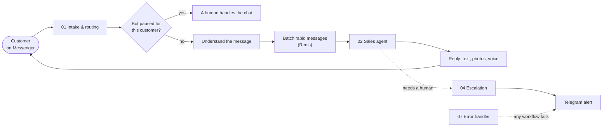
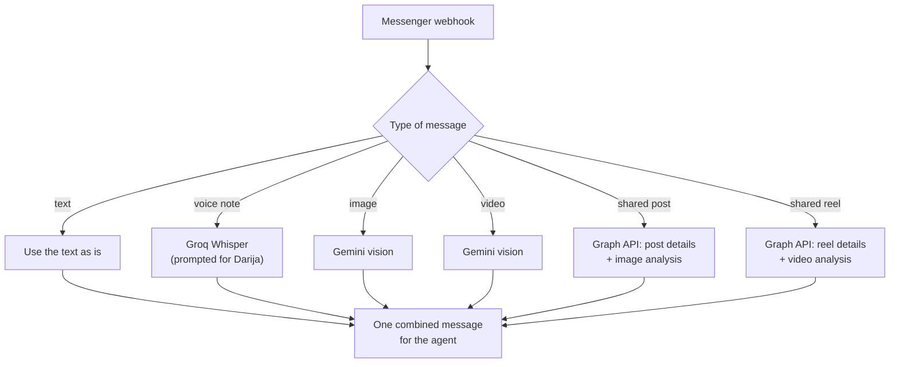
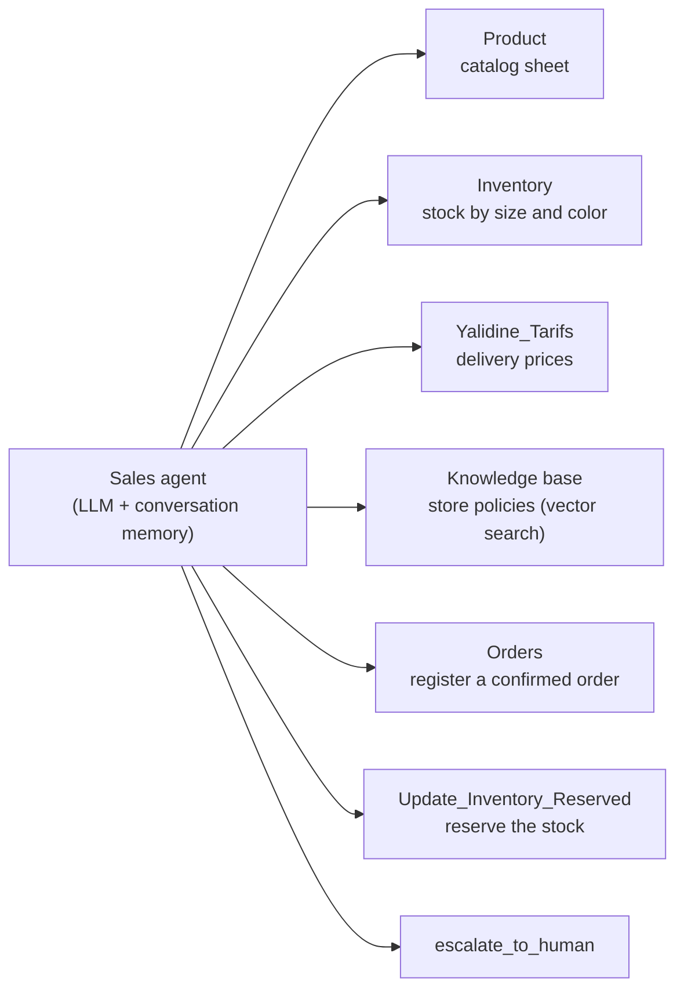
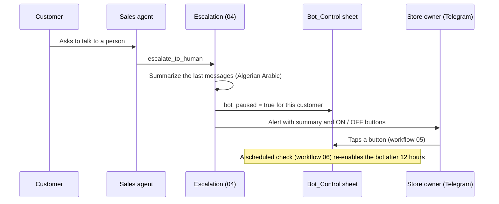
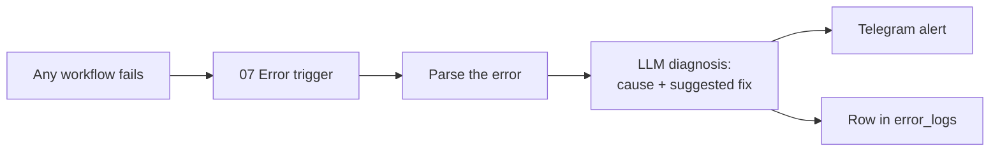

# Architecture

The system is split into eight small n8n workflows. This page shows how they fit together.

## 1. Big picture

## 2. Understanding what the customer sent

Workflow 01 detects the message type and turns everything into text before the agent sees it.

Messages the store owner sends manually from the Page inbox arrive as "echo" events. They are detected and stored in the conversation memory instead of being answered.

**Batching.** Each customer has a short-lived buffer in Redis. Messages are appended to it, a lock makes sure only one run answers, the run waits 20 seconds, then reads the whole buffer and answers once.

## 3. The sales agent and its tools

Order closing follows a fixed sequence enforced by the prompt: confirm the exact variant and quantity, collect customer details, show the total (product price plus real delivery fee), get explicit confirmation, register the order, then reserve the stock.

After the agent answers, a formatting step extracts product image links, and the reply is sent as text, as product photos, or as a voice note (generated with ElevenLabs) when the customer sent a voice note.

## 4. Human handoff

## 5. Error monitoring

## 6. Where data lives

| Data | Where | Why |
|------|-------|-----|
| Catalog, stock, delivery tariffs, orders | Google Sheets | Easy for a shop owner to edit |
| Bot on/off per customer | Google Sheets (`Bot_Control`) | Visible and editable by the owner |
| Conversation memory | Postgres | Persistent context per customer |
| Message buffer and lock | Redis | Fast, expires automatically |
| Store policies | Supabase vector store | Semantic search instead of guessing |
| Error log | Postgres (`error_logs`) | History of failures with the AI diagnosis |
